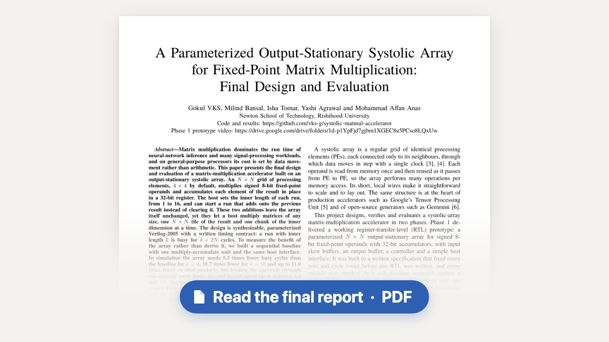
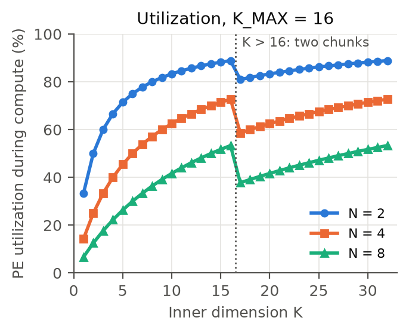
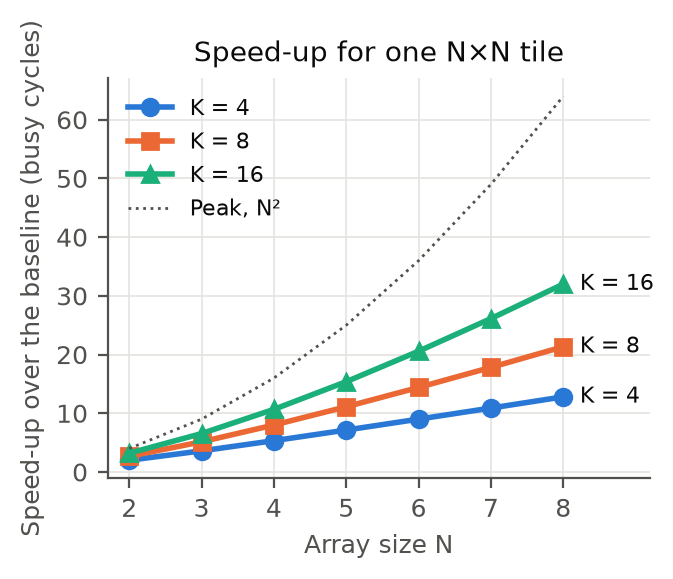
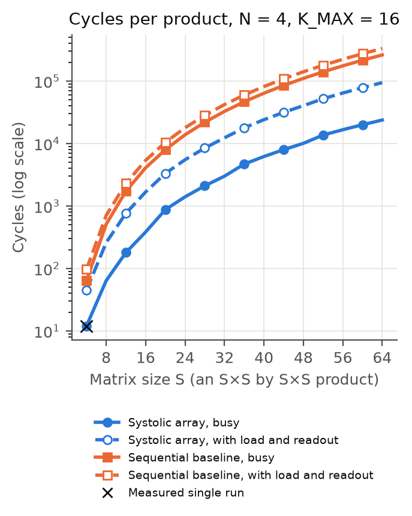
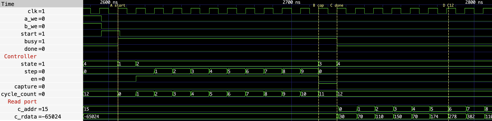

<div align="center">

# systolic-matmul-accelerator

**A parameterized output-stationary systolic array for fixed-point matrix multiplication, in Verilog**

Modern Computer Architecture, Project 12: Systolic Array Matrix Multiplication Accelerator.

[](#results)
[](rtl/)
[](docs/setup.md)
[](docs/setup.md)
[](https://github.com/vks-g/systolic-matmul-accelerator/actions/workflows/sim.yml)
[](https://github.com/vks-g/systolic-matmul-accelerator/actions/workflows/synth.yml)

<table>
  <tr>
    <td align="center" width="34%">
      <a href="reports/phase2/main.pdf"></a>
      <br><b><a href="reports/phase2/main.pdf">Read the final report (PDF)</a></b>
      <br>12 pages · <a href="reports/phase2/">LaTeX source</a>
    </td>
    <td align="center" width="33%">
      <a href="https://drive.google.com/drive/folders/1d-p1YpFjd7gjbm1XGEC8u5PCso8LQxUw?usp=sharing"></a>
      <br><b><a href="https://drive.google.com/drive/folders/1d-p1YpFjd7gjbm1XGEC8u5PCso8LQxUw?usp=sharing">▶ Watch the prototype video</a></b>
      <br>4:42 · all five members present their work
    </td>
    <td align="center" width="33%">
      <a href="reports/phase1/main.pdf"></a>
      <br><b><a href="reports/phase1/main.pdf">Read the Phase 1 report (PDF)</a></b>
      <br>7 pages · <a href="reports/phase1/">LaTeX source</a>
    </td>
  </tr>
</table>

[Setup guide](docs/setup.md) · [Architecture spec](docs/spec.md) · [Live demo](#live-demo-make-demo) · [Results](#results) · [Synthesis](#synthesis) · [Team](#team) · [Contributing](CONTRIBUTING.md)

</div>

## Phase 2 deliverables

| Required | Where it is |
|---|---|
| Final IEEE report: results and discussion, conclusion | [`reports/phase2/main.pdf`](reports/phase2/main.pdf), built from [`reports/phase2/`](reports/phase2/) |
| Inner lengths other than N, and products larger than the array | Run-time `k_len` and `accumulate` in [`rtl/control/`](rtl/control/) and [`rtl/buffers/`](rtl/buffers/); tiling procedure in [spec section 12](docs/spec.md) |
| Measured sequential baseline | [`rtl/baseline/seq_matmul.v`](rtl/baseline/seq_matmul.v), same host ports as the array; [comparison](#measured-speed-up-against-the-sequential-baseline) |
| Synthesis: resources and maximum frequency | [`synth/`](synth/README.md), results in [`results/phase2/synth/`](results/phase2/synth/) |
| Live demonstration | [`make demo`](#live-demo-make-demo) |
| Evidence | [cycle counts, speed-ups and plots](results/phase2/), [waveform captures](results/phase2/waveforms/captions.md), [architecture diagrams](docs/architecture/README.md) |

## Phase 1 deliverables

| Required | Where it is |
|---|---|
| IEEE report: abstract, literature review, proposed solution, individual contributions, references | [`reports/phase1/main.pdf`](reports/phase1/main.pdf), built from [`reports/phase1/`](reports/phase1/) |
| Prototype video, at most 5 minutes | [Google Drive, 4:42](https://drive.google.com/drive/folders/1d-p1YpFjd7gjbm1XGEC8u5PCso8LQxUw?usp=sharing); [script and segment notes](media/phase1/README.md) |
| Prototype files and implementation | [`rtl/`](rtl/) Verilog, [`tb/`](tb/) self-checking testbenches, [`model/`](model/) Python golden model, [`Makefile`](Makefile) |
| Project artefacts | [simulation logs, waveform captures and cycle counts](results/phase1/), [architecture diagrams](docs/architecture/README.md), [interface and timing spec](docs/spec.md) |
| Individual contributions | Section VII of the report, the [team table](#team) below, and each member's commits and pull requests |

## Idea

Matrix multiplication is the core operation of neural-network inference. A systolic array computes it with a grid of small processing elements (PEs) that each do one multiply-accumulate (MAC) per cycle. Operands pulse through the grid from neighbour to neighbour, so every value fetched from memory is reused across a whole row or column of PEs.

This project builds a parameterized N×N array (default 4×4) with an **output-stationary** dataflow:

- rows of **A** enter from the left and move right, skewed so row `i` starts `i` cycles late;
- columns of **B** enter from the top and move down, skewed so column `j` starts `j` cycles late;
- PE `(i, j)` keeps `C[i][j]` in its accumulator and adds `A[i][k] · B[k][j]` when the two operands meet.

One run multiplies an N×`k_len` block of A by a `k_len`×N block of B, with `k_len` from 1 to `K_MAX = 16`. It takes `k_len + 2N − 2` compute cycles, plus one to clear and one to capture: **12 busy cycles** for `k_len = 4` and 24 for `k_len = 16`. The sequential single-MAC baseline, built in RTL with the same ports, needs `N² · k_len`: 64 and 256. An accumulate run skips the clear and adds onto the previous C, so a host can multiply matrices of any size tile by tile. See [Results](#results).

## Architecture diagrams



[All six diagrams, editable sources and SVG/PNG exports](docs/architecture/README.md)
cover the system with `k_len` and `accumulate`, PE internals, the 4×4 wavefront,
the controller FSM with the accumulate path, tiling of products larger than the
array, and the sequential baseline, following
[the architecture contract](docs/spec.md).

The host loads A and B through independent row-major write ports, sets the
run's inner length `k_len` (1 to `K_MAX = 16`) and `accumulate`, pulses `start`
for one cycle, waits for `done`, and reads C through `c_addr` / `c_rdata`. The
controller sequences `IDLE → CLEAR → COMPUTE → CAPTURE → DONE`, skipping
`CLEAR` on an accumulate run so the products add onto the previous C; with
`k_len` chunks and N×N output tiles, matrices of any size can be multiplied
(see the [tiling diagram](docs/architecture/svg/tiling.svg)). Writes during
`busy` are ignored, and the previous C stays readable until the next capture.
Defaults are signed 8-bit operands, 32-bit accumulators, and `N = 4`; all
registers use `clk` and synchronous active-low `rst_n`.

## Status

| Component | Path | Issues | Status |
|---|---|---|---|
| Architecture spec and interface contract (v2: `k_len`, accumulate, tiling) | `docs/spec.md` | #2, #60 | Done |
| MAC unit and processing element | `rtl/pe/` | #6 | Implemented, self-checked |
| N×N array grid, K ≠ N and accumulation across runs | `rtl/array/` | #3, #61 | N=4 and N=3 tested |
| Input skew buffers and output readout for K ≠ N | `rtl/buffers/` | #10, #68 | Implemented, self-checked |
| Controller FSM with run-time `k_len` and accumulate | `rtl/control/` | #7, #65 | Implemented, self-checked |
| Top level: K ≠ N and tiled products through the host ports | `rtl/top/` | #4, #62 | 106 + 112 cases and 26 tiled products pass |
| Sequential single-MAC baseline, same host interface | `rtl/baseline/` | #64 | Implemented, self-checked |
| Golden model and vectors for K ≠ N and tiling | `model/` | #14, #72 | 52 model self-tests pass |
| Performance model and plots | `model/perf_model.py`, `results/phase2/figures/` | #73 | Done |
| End-to-end tests for K ≠ N and tiled products | `tb/tb_systolic_top.v` | #11, #69 | 6,078 checks pass |
| Synthesis: resources and Fmax on ECP5 | `synth/` | #75 | N = 2, 3, 4 and the baseline; N = 8 does not fit |
| Live demonstration | `model/demo.py` | #70 | `make demo` |
| Final report | `reports/phase2/main.pdf` | #63 | Done |

## Quick start

Install GNU Make, Icarus Verilog (`iverilog` / `vvp`), Verilator, Python 3.10+
and GTKWave or Surfer using the [platform-specific setup guide](docs/setup.md).
The viewer is needed only for `make waves`; lint and tests run without a GUI.

```sh
git clone https://github.com/vks-g/systolic-matmul-accelerator.git
cd systolic-matmul-accelerator
python3 -m venv .venv
. .venv/bin/activate
python -m pip install -r model/requirements.txt
make lint
make test
```

Run from the repository root with `.venv` active. `make lint` checks all eight
RTL modules using Verilator `--lint-only -Wall`. `make test` generates the golden
vectors (106 N×N cases, 112 K ≠ N cases and 26 tiled products, fixed seeds),
compiles Verilog-2005 with Icarus, and runs all eight self-checking testbenches.
A mismatch, missing `PASS` summary, compile error or nonzero simulator exit fails
the command. The expected totals are listed under [Results](#results).

### Live demo: `make demo`

```sh
make demo                          # random 8×20×8 product, seed 1
make demo M=9 K=33 P=7 SEED=4      # any size
make demo A=my_a.txt B=my_b.txt    # your own matrices, one row per line
make demo WAVES=1                  # also open the last tile's waveform
```

The demo multiplies one M×K by K×P product on `systolic_top`, tiled into N×N
output tiles and chunks of at most `K_MAX` with accumulate runs, and on
`seq_matmul`, through the same host ports. It prints A, B and C, checks both
results against NumPy, and prints both cycle counts. The default run ends with:

```
NumPy check (A @ B):
  systolic_top  matches
  seq_matmul    matches

Cycles               busy     total (load + start + busy + readout)
  systolic_top        140       532
  seq_matmul         1280      1672
  speed-up          9.14x     3.14x

PASS demo: 8x20x8 correct on both designs, busy-cycle speed-up 9.14x, end to end 3.14x
```

Matrix files hold integers from −128 to 127, separated by spaces or commas.

### Synthesis: `make synth`

`make synth` needs Yosys and nextpnr-ecp5 from the OSS CAD Suite; the
[setup guide](docs/setup.md#synthesis-phase-2) installs them on macOS, Linux and
WSL2.

```sh
make synth                 # systolic_top at N = 2, 3, 4, 8 and seq_matmul at N = 4
make synth SYNTH_N="2 4"   # choose the array sizes
```

It writes the logs, timing reports, `synth_summary.csv` and `critical_paths.md`
to [`results/phase2/synth/`](results/phase2/synth/). Placement uses a fixed seed,
so the numbers repeat on the same platform build; the [Synthesis CI](.github/workflows/synth.yml)
reruns the sweep and fails if the committed summary changes. See
[`synth/README.md`](synth/README.md) for the flow.

### Waveforms and Python checks

```sh
make waves                                    # top-level VCD in GTKWave, else Surfer
make waves WAVE_MODULE=pe VIEWER=surfer
python -m unittest discover -s model -v       # 52 golden/performance-model self-tests
python -m unittest discover -s tests -v       # 6 Make/viewer-selection tests
```

Generated VCDs and logs are in `build/`; the annotated
[report waveform layouts](sim/waves/) are optional. The
[setup guide](docs/setup.md#common-problems) covers missing tools and viewers.
[`CI`](.github/workflows/sim.yml) runs `make lint test` and the viewer-selection
checks on pull requests and pushes to `dev`.

## Results

All eight RTL modules pass lint. `make test` passes **45,051 / 45,051 checks**:

| Testbench | Checks passed | Coverage |
|---|---:|---|
| `tb_mac` | 20 / 20 | Signed products, accumulation, clear/reset and enable |
| `tb_pe` | 15 / 15 | MAC plus registered operand forwarding and stalls |
| `tb_sa_controller` | 242 / 242 | Every cycle of a run for N = 4 and N = 3, run-time `k_len`, the accumulate path |
| `tb_input_skew_buffer` | 2,608 / 2,608 | Row/column skew for every `k_len`, padding and stored operands |
| `tb_output_buffer` | 96 / 96 | Capture, row-major readout and holding results |
| `tb_systolic_array` | 27,510 / 27,510 | N=4 and N=3 arrays, K ≠ N, accumulation across runs, stalls and restart |
| `tb_systolic_top` | 6,078 / 6,078 | 106 N×N and 112 K ≠ N golden cases, 26 tiled products, host-interface checks |
| `tb_seq_matmul` | 8,482 / 8,482 | The baseline on the same vectors, through the same ports, and its `N² · k_len` busy cycles |

Every expected C comes from the Python golden model, never from RTL output.
Cycle counts are recorded in [`results/phase2/cycle_counts.csv`](results/phase2/cycle_counts.csv)
(array, K ≠ N), [`baseline_cycles.csv`](results/phase2/baseline_cycles.csv),
[`tiled_cycles.csv`](results/phase2/tiled_cycles.csv) and
[`speedup.csv`](results/phase2/speedup.csv).

### K ≠ N: run-time inner length

All 112 K ≠ N cases (`k_len` 1 to 16) finish in exactly `k_len + 2N` busy cycles,
with `k_len + 2N − 2` compute steps. An accumulate run skips the clear and takes
one cycle fewer. Each PE is busy for `k_len` of the compute steps, so utilization
rises from 40 % at `k_len = 4` to 72.7 % at `k_len = 16`.



### Measured speed-up against the sequential baseline

Both designs run the same 26 tiled products (6 directed, 20 random) through the
same host ports. **Busy** counts the cycles from each accepted `start` to `done`;
**total** adds loading the operands, the start pulses and reading C.

| Product (M×K×P) | Array busy | Baseline busy | Speed-up | Array total | Baseline total | Speed-up |
|---|---:|---:|---:|---:|---:|---:|
| 8×8×8 | 64 | 512 | 8.0 | 260 | 708 | 2.7 |
| 5×7×6 | 60 | 448 | 7.5 | 240 | 628 | 2.6 |
| 4×40×4 | 62 | 640 | 10.3 | 241 | 819 | 3.4 |
| 9×33×7 | 330 | 3,168 | 9.6 | 1,236 | 4,074 | 3.3 |
| 1×1×1 | 9 | 16 | 1.8 | 30 | 37 | 1.2 |
| 4×64×4 | 93 | 1,024 | 11.0 | 369 | 1,300 | 3.5 |

Over all 26 products the busy-cycle speed-up ranges from **1.8 to 11.0** and the
end-to-end speed-up from **1.2 to 3.5**. The busy speed-up grows with K, because
the array pays its fill and drain once per chunk while the baseline pays N²
cycles for every element of K. End to end, the one-element-per-cycle host ports
limit throughput: loading a run's operands takes `N · k_len` cycles, more than
the run itself.

The [performance model](model/perf_model.py) extends these measurements to
other sizes (its single-run point matches the measured 12 cycles):

| Busy-cycle speed-up for one N×N tile | Cycles per S×S product, N = 4 |
|---|---|
|  |  |

The [Phase 2 waveform captures](results/phase2/waveforms/captions.md) show a
`k_len = 5` run, an accumulate chain, and the baseline computing one element at a time.

### Synthesis

Lattice ECP5 LFE5U-25F (28 `MULT18X18D`), Yosys `synth_ecp5` and nextpnr-ecp5,
100 MHz clock constraint, fixed seed. From
[`synth_summary.csv`](results/phase2/synth/synth_summary.csv):

| Design | N | LUT4 | FF | MULT18X18D | Fmax (MHz) |
|---|---:|---:|---:|---:|---:|
| `systolic_top` | 2 | 1,243 | 847 | 4 | 60.40 |
| `systolic_top` | 3 | 2,495 | 1,487 | 11 | 38.06 |
| `systolic_top` | 4 | 2,506 | 2,287 | 16 | 56.83 |
| `seq_matmul` (baseline) | 4 | 3,735 | 1,617 | 1 | 52.16 |

- At N = 4 the array uses 1.4 times the flip-flops of the baseline and 33 % fewer
  LUTs, and runs 9 % faster (56.83 against 52.16 MHz). No configuration meets
  100 MHz.
- **N = 8 does not fit:** it needs 64 multipliers and the device has 28.
- **N = 3 is the slowest.** Two of its 11 multipliers are in the B skew buffer,
  whose read address `k·N + l` is a real multiplication when N is not a power of
  two. Its critical path runs through that multiplier and then the PE
  multiplier. Keeping N a power of two keeps the buffer addressing free.
- In every array size the slowest path runs from a skew-buffer counter through
  a PE's multiply-accumulate. The paths with their source lines are in
  [`critical_paths.md`](results/phase2/synth/critical_paths.md).

### Phase 1 results

Phase 1 fixed `k_len = N = 4`: 10,349 checks across seven testbenches, and all 106
golden runs recorded 10 compute and 12 busy cycles
([`cycle_counts.csv`](results/phase1/cycle_counts.csv),
[logs](results/phase1/logs/)). The single-MAC reference was then analytical; Phase 2
measures it in RTL (64 busy cycles at `k_len = 4`, a 5.3× speed-up).



Known golden case 5: **A** marks the accepted start, **B** entry to CAPTURE
after ten compute steps, **C** completion with `cycle_count = 12`, and **D** readout of
`C[1][2] = 278` at address 6. The [capture captions](results/phase1/waveforms/captions.md)
explain this and the PE/array captures. See the [Phase 1 report](reports/phase1/main.pdf)
and the [video notes and script](media/phase1/README.md).

## Limitations

- The host writes and reads one element per cycle, so operand loading, not the
  array, limits end-to-end throughput.
- The wavefront's `2N − 2` fill and drain cycles are paid on every run, so a PE
  is busy for at most 72.7 % of the compute steps at `K_MAX = 16`.
- Results stay at 32 bits, with no rounding or saturation.
- The critical path through the skew buffer and the combinational MAC limits the
  clock; registering the buffer outputs would cut it at the cost of one cycle per run.

## Repository structure

```
├── rtl/                 synthesizable Verilog-2005, one module per file
│   ├── include/         shared parameters (sa_params.vh)
│   ├── pe/              MAC unit and processing element
│   ├── array/           N×N grid of PEs
│   ├── buffers/         input skew buffers, output/accumulator readout
│   ├── control/         controller FSM
│   ├── top/             top level with the matrix data interface
│   └── baseline/        sequential single-MAC baseline (seq_matmul)
├── tb/                  self-checking testbenches, tb_<module>.v
├── model/               golden model, vector generator, performance model, demo
├── sim/waves/           GTKWave layouts (.gtkw)
├── synth/               ECP5 synthesis flow (Yosys, nextpnr-ecp5)
├── docs/                interface/timing spec, setup guide, architecture diagrams
├── results/phase1/      Phase 1 waveform captures, simulation logs, cycle counts
├── results/phase2/      cycle counts, speed-ups, plots, waveforms, synthesis results
├── reports/phase1/      Phase 1 IEEE report: main.tex, sections/, refs.bib, main.pdf
├── reports/phase2/      final IEEE report: main.tex, sections/, refs.bib, main.pdf
├── media/phase1/        video script; the video itself is linked, not committed
└── media/phase2/        README thumbnail of the final report
```

## Team

| Name | GitHub | Phase 1 work | Phase 2 work |
|---|---|---|---|
| Gokul VKS (lead) | [@vks-g](https://github.com/vks-g) | Architecture spec and interface contract, array grid, top level, report assembly, video edit | Spec v2, array and top level for K ≠ N and tiling, final report assembly |
| Milind Bansal | [@MilindDevX](https://github.com/MilindDevX) | MAC unit and processing element, controller, waveform captures, PE and controller report sections | Sequential baseline, controller `k_len` and accumulate, Phase 2 waveforms, baseline report section |
| Isha Tomar | [@Bytebard089](https://github.com/Bytebard089) | Input skew and output buffers, end-to-end testbench, video script, dataflow and status report sections | Buffers for K ≠ N, end-to-end K ≠ N and tiling tests, `make demo`, results report section |
| Yashi Agrawal | [@11yashiagrawal](https://github.com/11yashiagrawal) | Python golden model and test-vector generator, literature review and references | Golden model for K ≠ N and tiling, performance model and plots, literature review |
| Mohammad Affan Anas | [@affan80](https://github.com/affan80) | Setup guide, Makefile and CI, architecture diagrams, README, verification report section, clean-clone check | Synthesis flow, Phase 2 diagrams, README, synthesis and verification report sections, clean-clone check |

Each piece of work was tracked in a GitHub issue and merged into `dev` through a pull request, so the commit history shows who wrote what. The report's Individual Contributions section has the full list.
