<div align="center">

# systolic-matmul-accelerator

**A 4×4 output-stationary systolic array for fixed-point matrix multiplication, in Verilog**

Modern Computer Architecture, Project 12: Systolic Array Matrix Multiplication Accelerator.

[](#status)
[](rtl/)
[](docs/setup.md)
[](docs/setup.md)

[Phase 1 report](reports/phase1/) · Prototype video (link added by #12) · [Contributing](CONTRIBUTING.md)

</div>

## Idea

Matrix multiplication is the core operation of neural-network inference. A systolic array computes it with a grid of small processing elements (PEs) that each do one multiply-accumulate (MAC) per cycle. Operands pulse through the grid from neighbour to neighbour, so every value fetched from memory is reused across a whole row or column of PEs.

This project builds a parameterized N×N array (default 4×4) with an **output-stationary** dataflow:

- rows of **A** enter from the left and move right, skewed so row `i` starts `i` cycles late;
- columns of **B** enter from the top and move down, skewed so column `j` starts `j` cycles late;
- PE `(i, j)` keeps `C[i][j]` in its accumulator and adds `A[i][k] · B[k][j]` when the two operands meet.

For an N×N by N×N product, the array finishes in `3N − 2` compute cycles (10 for 4×4), against N³ = 64 cycles for a single sequential MAC.

## Architecture diagrams



[All four diagrams, editable sources and SVG/PNG exports](docs/architecture/README.md)
cover the system, PE internals, 4×4 wavefront and controller states, following
[the architecture contract](docs/spec.md).

## Status

| Component | Path | Issue | Status |
|---|---|---|---|
| Architecture spec and interface contract | `docs/spec.md` | #2 | planned |
| MAC unit and processing element | `rtl/pe/` | #6 | planned |
| N×N array grid | `rtl/array/` | #3 | planned |
| Input skew buffers and output readout | `rtl/buffers/` | #10 | planned |
| Controller FSM | `rtl/control/` | #7 | planned |
| Top level and matrix data interface | `rtl/top/` | #4 | planned |
| Python golden model and test vectors | `model/` | #14 | planned |
| End-to-end self-checking testbench | `tb/tb_systolic_top.v` | #11 | planned |
| Synthesis, Fmax, resources, sequential baseline | `synth/`, `rtl/baseline/` | Phase 2 | – |

## Quick start

Filled in by #17 and #19. The intended flow:

```sh
make lint    # Verilator lint of all RTL
make test    # generate golden vectors and run every self-checking testbench
make waves   # open the end-to-end waveform in GTKWave
```

## Repository structure

```
├── rtl/                 synthesizable Verilog-2005, one module per file
│   ├── include/         shared parameters (sa_params.vh)
│   ├── pe/              MAC unit and processing element
│   ├── array/           N×N grid of PEs
│   ├── buffers/         input skew buffers, output/accumulator readout
│   ├── control/         controller FSM
│   └── top/             top level with the matrix data interface
├── tb/                  self-checking testbenches, tb_<module>.v
├── model/               Python golden reference and test-vector generator
├── sim/waves/           GTKWave layouts (.gtkw)
├── synth/               Phase 2: synthesis scripts and constraints
├── docs/                spec, setup guide, verification plan, architecture diagrams
├── results/phase1/      waveform captures, simulation logs, cycle counts
├── reports/phase1/      IEEE LaTeX report: main.tex, sections/, refs.bib, main.pdf
└── media/phase1/        video script; the video itself is linked, not committed
```

## Team

| Name | GitHub |
|---|---|
| Gokul VKS (lead) | [@vks-g](https://github.com/vks-g) |
| Milind Bansal | [@MilindDevX](https://github.com/MilindDevX) |
| Isha Tomar | [@Bytebard089](https://github.com/Bytebard089) |
| Yashi Agrawal | [@11yashiagrawal](https://github.com/11yashiagrawal) |
| Mohammad Affan Anas | [@affan80](https://github.com/affan80) |

Who built what is tracked through the GitHub issues and listed in the report's Individual Contributions section.
