# Architecture diagrams

Figures for [issue #18](https://github.com/vks-g/systolic-matmul-accelerator/issues/18),
for the repository README, Phase 1 report and prototype video. The contract is
[`docs/spec.md`](../spec.md); the figures describe Phase 1 (`K = N`, default
`N = 4`, signed `DATA_W = 8`, signed `ACC_W = 32`).

## Figures and editable sources

| Figure | Editable Mermaid | SVG | PNG | Contract |
|---|---|---|---|---|
| System architecture | [system.mmd](src/system.mmd) | [system.svg](svg/system.svg) | [system.png](png/system.png) | Spec §§6.3–6.7, 7.5 |
| PE internals | [pe.mmd](src/pe.mmd) | [pe.svg](svg/pe.svg) | [pe.png](png/pe.png) | Spec §§4, 6.1–6.2 |
| 4×4 skewed wavefront | [dataflow.mmd](src/dataflow.mmd) | [dataflow.svg](svg/dataflow.svg) | [dataflow.png](png/dataflow.png) | Spec §§2, 7.1–7.2 |
| Controller state transitions | [controller.mmd](src/controller.mmd) | [controller.svg](svg/controller.svg) | [controller.png](png/controller.png) | Spec §§6.6, 7.3–7.5; [issue #7](https://github.com/vks-g/systolic-matmul-accelerator/issues/7) |

### System architecture



Solid arrows carry data; dashed arrows carry controller signals. Host write,
command/status and read ports are listed at their respective blocks. All
registers share
`clk` and synchronous active-low `rst_n`; reset/clock fanout is omitted for
clarity.

The storage and skew boxes are functional parts of each **single**
`input_skew_buffer` instance. Skew is combinational selection by `step`,
not another registered pipeline stage. The top-level integration shown is
specified by §6.7 and owned by issue #4; it is not evidence that
`rtl/top/systolic_top.v` has landed. Write gating belongs in that top level.

### PE internals



The MAC uses the current `a_in` and `b_in`. The forwarding registers carry
those operands to neighbours one enabled cycle later; they do not add an
extra stage before the local multiply. `!rst_n` or `clear` zeroes all three
registers with priority over `en`. With `en = 0`, the accumulator and both
forwarding registers hold.

### Skewed wavefront



The snapshot is **during compute step `t = 3`, before its rising edge**:

- Lane `i` of A carries `A[i][t-i]`; lane `j` of B carries `B[t-j][j]`.
  The four lane delays are 0, 1, 2 and 3 cycles on each edge.
- PE `(i,j)` consumes `A[i][k]` and `B[k][j]`, where `k = t-i-j`.
  The displayed `k` grid is exactly the step-3 table in spec §7.2.
- Green cells mark the first term (`k = 0`); blue cells consume later terms.
  Gray cells add zero, but still update their forwarding registers when
  `en = 1`. Each accumulator retains its own `C[i][j]` in place.
- Inputs outside `0 <= k < K` are zero. The edges go quiet at steps 7–9,
  while the last operands drain to PE `(3,3)`. Its final term lands at
  step 9: ten compute cycles in total.

### Controller



State names, Moore outputs and transitions match `rtl/control/sa_controller.v`
from issue #7. The figure shows logical state names, not an encoding.
`start` is accepted only in `IDLE` or `DONE`; pulse it for one cycle.
`DONE` holds until another accepted `start` or reset. `cycle_count` resets
on an accepted start, increments at each busy-cycle edge, and holds in
`DONE`. Reset takes precedence from every state.

`CLEAR` and `CAPTURE` each take one cycle. `COMPUTE` takes
`T = K + 2N - 2 = 10` cycles, so `busy` lasts `T + 2 = 12` cycles and
`cycle_count = 12` in `DONE`. Capture occurs on the edge **after** the last
MAC update, so the output buffer receives the complete result.

## Edit and regenerate

Edit the `.mmd` files and regenerate **both** export formats in the same PR.
[Mermaid CLI](https://github.com/mermaid-js/mermaid-cli) converts the sources;
[`src/mermaid-config.json`](src/mermaid-config.json) defines the shared palette
and typography. The grid uses Mermaid's `block-beta` syntax to keep all
sixteen PEs in their physical row/column positions.

From the repository root, with Node.js 20+ and npm available:

```sh
sh docs/architecture/export.sh
```

The script pins Mermaid CLI to **11.12.0**. Its first invocation uses npm's
cache and may download the renderer and Puppeteer's headless browser;
subsequent runs reuse them. No Node dependency is added to RTL simulation.
The script renders SVG and PNG from each source at viewport width 2400;
PNGs use scale 2 for report/video use. Use the same renderer version and
fonts when comparing exports across machines.

Every export has a white background, dark labels and explicit node fills,
so it stays legible when embedded on either a light or dark page. Color
is supplementary: term indices, state names, arrow directions and the
legend carry the meaning without color. SVG labels use text rather than
HTML foreign objects. To review an edit, inspect both formats for clipped
text, overlapping arrows and labels, and confirm them against the spec
sections listed above.

## Reuse

Use SVG for web pages and scalable viewing; use PNG for slides, video and
LaTeX. The report already searches `docs/architecture/png/` via
`graphicspath`; a section owner can include, for example:

```tex
\includegraphics[width=\columnwidth]{pe.png}
```

For larger figures, use a two-column `figure*` and constrain both dimensions
with `width=\textwidth,height=0.8\textheight,keepaspectratio`. Report section
text, figure numbering and the built PDF remain with their respective owners.
