# Architecture diagrams

Figures for the repository README, the Phase 1 and Phase 2 reports and the
prototype video. The Phase 1 set ([issue #18](https://github.com/vks-g/systolic-matmul-accelerator/issues/18))
describes the original contract; the Phase 2 update ([issue #76](https://github.com/vks-g/systolic-matmul-accelerator/issues/76),
contract version 2 in [issue #60](https://github.com/vks-g/systolic-matmul-accelerator/issues/60))
adds the run-time inner length `k_len`, accumulate runs, tiling and the
sequential baseline. The contract is [`docs/spec.md`](../spec.md); defaults are
`N = 4`, `K_MAX = 16`, signed `DATA_W = 8`, signed `ACC_W = 32`.

## Figures and editable sources

| Figure | Editable Mermaid | SVG | PNG | Contract |
|---|---|---|---|---|
| System architecture (`k_len`, `accumulate`) | [system.mmd](src/system.mmd) | [system.svg](svg/system.svg) | [system.png](png/system.png) | Spec §§6.3–6.7, 7.5 |
| PE internals | [pe.mmd](src/pe.mmd) | [pe.svg](svg/pe.svg) | [pe.png](png/pe.png) | Spec §§4, 6.1–6.2 |
| 4×4 skewed wavefront | [dataflow.mmd](src/dataflow.mmd) | [dataflow.svg](svg/dataflow.svg) | [dataflow.png](png/dataflow.png) | Spec §§2, 7.1–7.2 |
| Controller FSM with the accumulate path | [controller.mmd](src/controller.mmd) | [controller.svg](svg/controller.svg) | [controller.png](png/controller.png) | Spec §§6.6, 7.3–7.5; [issue #65](https://github.com/vks-g/systolic-matmul-accelerator/issues/65) |
| Tiling: output tiles and K chunks | [tiling.mmd](src/tiling.mmd) | [tiling.svg](svg/tiling.svg) | [tiling.png](png/tiling.png) | Spec §12 |
| Sequential baseline | [seq_baseline.mmd](src/seq_baseline.mmd) | [seq_baseline.svg](svg/seq_baseline.svg) | [seq_baseline.png](png/seq_baseline.png) | Spec §6.8; [issue #64](https://github.com/vks-g/systolic-matmul-accelerator/issues/64) |

### System architecture



The landscape figure follows the implemented
[`rtl/top/systolic_top.v`](../../rtl/top/systolic_top.v). Solid arrows bundle
related data buses; the dashed link groups controller fanout. The host sets
`k_len` (1 to `K_MAX`) and `accumulate` with each `start`; the controller
samples both and holds them as `run_k_len` for the run. Each input skew
buffer stores one operand block (A: `N` rows × `K_MAX`; B: `K_MAX` rows ×
`N`) and selects its skewed lanes combinationally from `step` and
`run_k_len`, so elements beyond `k_len` are never sent. `a_left` and `b_top`
are separate `N*DATA_W` buses, and `acc_flat` carries `N*N*ACC_W`
accumulator bits. Host write labels use common suffixes: A has `a_we`,
`a_addr`, `a_wdata`; B has `b_we`, `b_addr`, `b_wdata`. `c_rdata` is a
signed `ACC_W`-bit result. The top level gates both write enables with
`!busy`. All registers share `clk` and synchronous active-low `rst_n`;
individual clock/reset wires are omitted for clarity.

The system export is designed for a two-column report figure at **7.16 in
wide**, rather than a single column. At that width its 18-unit SVG labels
print at approximately **7.5 pt**. Check the PNG width, aspect ratio and
print-size label readability after layout edits.

### PE internals



The MAC uses the current `a_in` and `b_in`. The forwarding registers carry
those operands to neighbours one enabled cycle later; they do not add an
extra stage before the local multiply. `!rst_n` or `clear` zeroes all three
registers with priority over `en`. With `en = 0`, the accumulator and both
forwarding registers hold.

### Skewed wavefront



The snapshot is **during compute step `t = 3`, before its rising edge**, for
the Phase 1 case `k_len = N = 4`:

- Lane `i` of A carries `A[i][t-i]`; lane `j` of B carries `B[t-j][j]`.
  The four lane delays are 0, 1, 2 and 3 cycles on each edge.
- PE `(i,j)` consumes `A[i][k]` and `B[k][j]`, where `k = t-i-j`.
  The displayed `k` grid is exactly the step-3 table in spec §7.2.
- Green cells mark the first term (`k = 0`); blue cells consume later terms.
  Gray cells add zero, but still update their forwarding registers when
  `en = 1`. Each accumulator retains its own `C[i][j]` in place.
- Inputs outside `0 <= k < k_len` are zero. Any other `k_len` gives the same
  pattern: the edges go quiet after step `k_len + N - 2` and the array
  drains until step `k_len + 2N - 3`.

### Controller



State names, Moore outputs and transitions match
[`rtl/control/sa_controller.v`](../../rtl/control/sa_controller.v). The
figure shows logical state names, not an encoding. `start` is accepted only
in `IDLE` or `DONE`; pulse it for one cycle, and a `start` whose `k_len` is
0 or above `K_MAX` is ignored. `k_len` and `accumulate` are sampled with
`start` and held for the run. A normal start passes through `CLEAR`; an
**accumulate** start goes straight to `COMPUTE`, so the run adds onto the
previous accumulators. `DONE` holds until another accepted `start` or
reset. Reset takes precedence from every state.

`CLEAR` and `CAPTURE` each take one cycle. `COMPUTE` takes
`T = k_len + 2N - 2` cycles, so `busy` lasts `T + 2` cycles for a normal
run and `T + 1` for an accumulate run, and `cycle_count` reports that
number in `DONE`. Capture occurs on the edge **after** the last MAC update,
so the output buffer receives the complete result.

### Tiling



The array holds one `N × N` tile of `C`, and the buffers hold at most
`K_MAX` of the inner dimension, so a larger product runs as tiles × chunks
(spec §12). The example is the default demo's 8×20 by 20×8 product on the
default array (`N = 4`, `K_MAX = 16`): `C` splits into four `N × N` output
tiles and `K` into chunks 0–15 and 16–19 (`k_len = 4` for the last chunk).
Each tile takes one **normal** run for its first
chunk and one **accumulate** run per later chunk; partial sums stay in the
PEs between chunks and only the finished tile is read. Rows of A beyond `M`
and columns of B beyond `P` are zero-padded, and a short last chunk runs
with a smaller `k_len`.

### Sequential baseline



[`rtl/baseline/seq_matmul.v`](../../rtl/baseline/seq_matmul.v) keeps the
same ports, address map and host protocol as `systolic_top`, so the same
testbenches and the demo drive both designs (spec §6.8). One multiplier and
one adder compute `C` one element at a time, row-major, with `k_len`
multiply-accumulates per element: `N²·k_len` busy cycles per run, with no
clear or capture cycle. The running sum restarts at 0, or at the stored
`C[row][col]` on an accumulate run, and each finished element is written in
the cycle of its last product. The arithmetic matches the PE's MAC, so both
designs give bit-identical `C`.

## Edit and regenerate

Edit the `.mmd` files and regenerate **both** export formats in the same PR.
[Mermaid CLI](https://github.com/mermaid-js/mermaid-cli) converts the sources;
[`src/mermaid-config.json`](src/mermaid-config.json) defines the shared palette
and typography. The wavefront grid uses Mermaid's `block-beta` syntax to keep
all sixteen PEs in their physical row/column positions.

From the repository root, with Node.js 20+ and npm available:

```sh
sh docs/architecture/export.sh
```

The script pins Mermaid CLI to **11.12.0**. Its first invocation uses npm's
cache and may download the renderer and Puppeteer's headless browser;
subsequent runs reuse them. No Node dependency is added to RTL simulation.
The script renders SVG and PNG from each source at viewport width 2400;
PNGs use scale 2 for report/video use. Use the same renderer version and
fonts when comparing exports across machines.

Every export has a white background, dark labels and explicit node fills,
so it stays legible when embedded on either a light or dark page. Color
is supplementary: term indices, state names, arrow directions and the
legend carry the meaning without color. SVG labels use text rather than
HTML foreign objects. To review an edit, inspect both formats for clipped
text, overlapping arrows and labels, and confirm them against the spec
sections listed above.

## Reuse

Use SVG for web pages and scalable viewing; use PNG for slides, video and
LaTeX. The report already searches `docs/architecture/png/` via
`graphicspath`; a section owner can include, for example:

```tex
\includegraphics[width=\columnwidth]{pe.png}
```

Use a two-column `figure*` for the system diagram so its labels retain their
intended print size (7.16 in wide with this report's template):

```tex
\begin{figure*}[t]
\centering
\includegraphics[width=\textwidth]{system.png}
\caption{System architecture of the output-stationary accelerator.}
\label{fig:system}
\end{figure*}
```

Report section text, figure numbering and the built PDF remain with their
respective owners.
