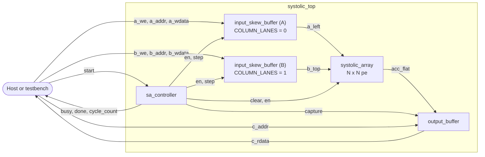
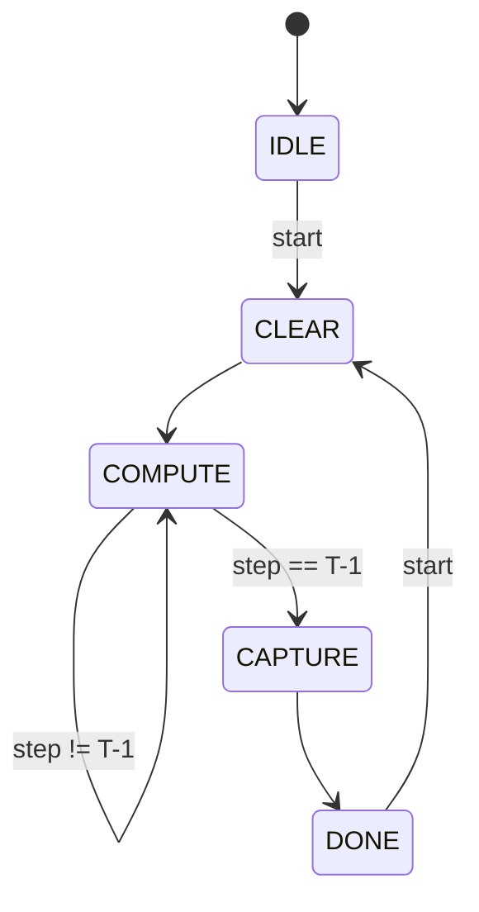

# Architecture spec and interface contract

This document is the contract every module is built and tested against (issue #2). Port names, widths, timing and the handshake defined here are fixed. To change any of them, open a PR against this file first and tag the owners of the affected modules.

## 1. What the accelerator does

It computes **C = A × B** for signed fixed-point matrices, with A and B both N×N and N = 4 by default:

```
C[i][j] = sum over k = 0 .. K-1 of  A[i][k] * B[k][j]
```

In Phase 1 the inner dimension K equals N. The formulas below keep K separate so they still hold when Phase 2 relaxes that.

A host (the testbench in Phase 1) loads A and B through two write ports, pulses `start`, waits for `done`, and reads C through a read port.

## 2. Dataflow: output-stationary

The array is an N×N grid of processing elements (PEs). PE (i, j) owns `C[i][j]` and keeps it in its accumulator for the whole computation. Only the operands move:

- **A moves right.** Row i of A enters PE (i, 0) from the left edge and is passed one PE to the right every cycle.
- **B moves down.** Column j of B enters PE (0, j) from the top edge and is passed one PE down every cycle.
- **Inputs are skewed.** Row i of A starts i cycles late, and column j of B starts j cycles late. Then `A[i][k]` and `B[k][j]` reach PE (i, j) in the same cycle, and the PE multiplies them and adds the product to `C[i][j]`.

```
               b_top[0]  b_top[1]  b_top[2]  b_top[3]      B enters here,
                  |         |         |         |          column j skewed by j
                  v         v         v         v
a_left[0] --> PE(0,0) -> PE(0,1) -> PE(0,2) -> PE(0,3)
                  |         |         |         |
a_left[1] --> PE(1,0) -> PE(1,1) -> PE(1,2) -> PE(1,3)
                  |         |         |         |
a_left[2] --> PE(2,0) -> PE(2,1) -> PE(2,2) -> PE(2,3)
                  |         |         |         |
a_left[3] --> PE(3,0) -> PE(3,1) -> PE(3,2) -> PE(3,3)

A enters here, row i skewed by i.   Each PE keeps C[i][j] in place.
```

Output-stationary was chosen because each result stays in one place, so reading C out needs no extra movement, and every step of the computation is easy to see in a waveform. Weight-stationary and other dataflows are discussed in the literature review (#15).

## 3. Parameters

Defaults live in [`rtl/include/sa_params.vh`](../rtl/include/sa_params.vh). Each module declares the parameters it uses with those defaults and computes the derived widths itself.

| Parameter | Default | Meaning |
|---|---|---|
| `N` | 4 | Array is N×N PEs; matrices are N×N |
| `DATA_W` | 8 | Operand width, signed two's complement |
| `ACC_W` | 32 | Accumulator and result width, signed two's complement |
| `FRAC_W` | 0 | Fractional bits in the fixed-point reading of operands (interpretation only) |
| `CYC_W` | 32 | Width of `cycle_count` |

| Derived (localparam) | Formula | N = 4 |
|---|---|---|
| `K` | `N` | 4 |
| `T` (compute cycles) | `K + 2*N - 2` | 10 |
| `ADDR_W` | `$clog2(N*N)` | 4 |
| `STEP_W` | `$clog2(K + 2*N - 2)` | 4 |

## 4. Number format

- **Operands** are `DATA_W`-bit signed integers, from −128 to 127 for the default.
- **Products** are `2*DATA_W` bits wide and are sign-extended to `ACC_W` before they are added.
- **Accumulators** are `ACC_W`-bit signed. The largest possible magnitude is `K * 2^(2*DATA_W - 2)`, reached when every operand is −128: for K = 4 that is 65,536, which needs 18 bits. With `ACC_W = 32`, overflow cannot happen for any K below 131,072, so the RTL does not saturate.
- **Fixed-point reading.** With `FRAC_W = f`, an operand's bit pattern `x` means `x / 2^f` (format Q(`DATA_W` − 1 − f).f). A result `C` then has `2f` fractional bits and means `C / 2^(2f)`. To return it to the operands' format, shift it right arithmetically by f. Phase 1 reads every result at full precision, so f = 0 and the reference model compares plain integers. Rounding and saturating back to `DATA_W` bits is Phase 2 work.

### Signed arithmetic pitfalls

Verilog makes an expression unsigned as soon as one operand is unsigned, and then it zero-extends. Two rules prevent this:

1. Wrap every slice of a flattened bus in `$signed(...)` before using it in arithmetic. Slices are always unsigned.
2. Form the product at its natural width, then sign-extend it explicitly:

```verilog
wire signed [2*DATA_W-1:0] prod = a * b;   // a and b declared signed
acc <= acc + {{(ACC_W-2*DATA_W){prod[2*DATA_W-1]}}, prod};
```

## 5. Conventions for every module

- Synthesizable Verilog-2005. Each file starts with `` `default_nettype none `` and ends with `` `default_nettype wire ``.
- Every file, RTL and testbench alike, declares `` `timescale 1ns / 1ps `` on its first code line. If only some files declare it, Icarus warns that the others inherit it, and waveforms are easier to read in nanoseconds than in the default seconds. Testbenches use a 10 ns clock period.
- One clock, `clk`; every register updates on its rising edge.
- Reset is **synchronous and active-low**: `rst_n = 0` at a rising edge puts every register in this design into its reset value (zero, or `IDLE` for the controller).
- Ports that carry one value are declared `signed`. Ports that carry several values are flattened, unsigned buses with lane `l` at `[l*W +: W]`.
- Combinational outputs are named in this spec. Every other output comes straight from a register.

## 6. Modules and ports

`W` columns give the width in bits. `s` marks a signed port. "Reg" means the output comes straight from a register; "comb" means it is combinational.



### 6.1 `mac` — `rtl/pe/mac.v` (#6)

Parameters: `DATA_W`, `ACC_W`.

| Port | Dir | W | Description |
|---|---|---|---|
| `clk`, `rst_n` | in | 1 | Clock; synchronous active-low reset |
| `clear` | in | 1 | Zero the accumulator |
| `en` | in | 1 | Accumulate this cycle |
| `a`, `b` | in | `DATA_W` s | Operands |
| `acc` | out (reg) | `ACC_W` s | Running sum |

At each rising edge, in priority order: `!rst_n` or `clear` sets `acc <= 0`; otherwise `en` sets `acc <= acc + a*b` (sign-extended product, section 4); otherwise `acc` holds.

### 6.2 `pe` — `rtl/pe/pe.v` (#6)

Parameters: `DATA_W`, `ACC_W`. Contains one `mac` and two forwarding registers.

| Port | Dir | W | Description |
|---|---|---|---|
| `clk`, `rst_n` | in | 1 | Clock; synchronous active-low reset |
| `clear` | in | 1 | Zero the accumulator and both forwarding registers |
| `en` | in | 1 | Accumulate and forward this cycle |
| `a_in` | in | `DATA_W` s | Operand from the left neighbour (or the A edge) |
| `b_in` | in | `DATA_W` s | Operand from the neighbour above (or the B edge) |
| `a_out` | out (reg) | `DATA_W` s | `a_in` delayed one enabled cycle, to the right neighbour |
| `b_out` | out (reg) | `DATA_W` s | `b_in` delayed one enabled cycle, to the neighbour below |
| `acc` | out (reg) | `ACC_W` s | The `mac` accumulator, `C[i][j]` |

At each rising edge: `!rst_n` or `clear` zeroes `a_out`, `b_out` and `acc`; otherwise, when `en` is high, `a_out <= a_in`, `b_out <= b_in` and `acc <= acc + a_in*b_in`; otherwise all three hold. So an operand that enters a PE in one enabled cycle leaves it in the next.

### 6.3 `systolic_array` — `rtl/array/systolic_array.v` (#3)

Parameters: `N`, `DATA_W`, `ACC_W`. Instantiates N×N `pe` with `generate` loops.

| Port | Dir | W | Description |
|---|---|---|---|
| `clk`, `rst_n` | in | 1 | Clock; synchronous active-low reset |
| `clear`, `en` | in | 1 | Broadcast to every PE |
| `a_left` | in | `N*DATA_W` | Lane i drives `a_in` of PE (i, 0) |
| `b_top` | in | `N*DATA_W` | Lane j drives `b_in` of PE (0, j) |
| `acc_flat` | out (reg) | `N*N*ACC_W` | `acc` of PE (i, j) at `[(i*N+j)*ACC_W +: ACC_W]` |

Inside: `a_in` of PE (i, j) is `a_out` of PE (i, j−1), and `b_in` of PE (i, j) is `b_out` of PE (i−1, j). The `a_out` of the last column and the `b_out` of the last row are unused; waive that lint warning with a comment.

### 6.4 `input_skew_buffer` — `rtl/buffers/input_skew_buffer.v` (#10)

Parameters: `N`, `DATA_W`, `COLUMN_LANES`. It stores one N×N matrix and feeds it into one edge of the array with the skew. The top level instantiates it twice: `COLUMN_LANES = 0` for A (lane l is row l) and `COLUMN_LANES = 1` for B (lane l is column l).

| Port | Dir | W | Description |
|---|---|---|---|
| `clk`, `rst_n` | in | 1 | Clock; synchronous active-low reset (storage resets to 0) |
| `we` | in | 1 | Write `wdata` at `waddr` this cycle |
| `waddr` | in | `ADDR_W` | Row-major address: element (r, c) is at `r*N + c` |
| `wdata` | in | `DATA_W` s | Element value |
| `en` | in | 1 | Feeding is active (the controller's COMPUTE state) |
| `step` | in | `STEP_W` | Compute step `t`, from 0 to `T − 1` |
| `lanes` | out (comb) | `N*DATA_W` | Lane l at `[l*DATA_W +: DATA_W]` |

Storage `M` is written at the rising edge when `we` is high: `M[waddr / N][waddr % N] <= wdata`. Each lane `l` is combinational in `step` and `M`:

| Condition | `COLUMN_LANES = 0` (A) | `COLUMN_LANES = 1` (B) |
|---|---|---|
| `en` high and `0 <= t − l < K` | `M[l][t − l]` | `M[t − l][l]` |
| otherwise | 0 | 0 |

Compare `t >= l` before subtracting: `t − l` on unsigned values wraps around. An implementation built from shift registers is also fine, as long as the lanes match this table in every cycle.

### 6.5 `output_buffer` — `rtl/buffers/output_buffer.v` (#10)

Parameters: `N`, `ACC_W`.

| Port | Dir | W | Description |
|---|---|---|---|
| `clk`, `rst_n` | in | 1 | Clock; synchronous active-low reset (results reset to 0) |
| `capture` | in | 1 | Copy every accumulator into the result registers this cycle |
| `acc_flat` | in | `N*N*ACC_W` | From `systolic_array` |
| `c_addr` | in | `ADDR_W` | Row-major address of the result to read |
| `c_rdata` | out (comb) | `ACC_W` s | Result register at `c_addr` |

At the rising edge with `capture` high, all N×N result registers load `acc_flat` at once. They hold until the next capture, so the previous C stays readable while the next multiplication runs.

### 6.6 `sa_controller` — `rtl/control/sa_controller.v` (#7)

Parameters: `N`, `CYC_W`. Behaviour and timing are in section 7.

| Port | Dir | W | Description |
|---|---|---|---|
| `clk`, `rst_n` | in | 1 | Clock; synchronous active-low reset (to `IDLE`) |
| `start` | in | 1 | Begin a multiplication; sampled in `IDLE` and `DONE` only |
| `busy` | out | 1 | High in `CLEAR`, `COMPUTE` and `CAPTURE` |
| `done` | out | 1 | High in `DONE`: C is readable |
| `clear` | out | 1 | High in `CLEAR`, to the array |
| `en` | out | 1 | High in `COMPUTE`, to the array and both skew buffers |
| `step` | out (reg) | `STEP_W` | Compute step, 0 to `T − 1` in `COMPUTE`; 0 elsewhere |
| `capture` | out | 1 | High in `CAPTURE`, to the output buffer |
| `cycle_count` | out (reg) | `CYC_W` | Cycles spent busy in the current or last run |

`busy`, `done`, `clear`, `en` and `capture` are decoded from the state register only (Moore outputs), so they change only at clock edges.

### 6.7 `systolic_top` — `rtl/top/systolic_top.v` (#4)

Parameters: `N`, `DATA_W`, `ACC_W`, `CYC_W`. This is the matrix data interface the host sees.

| Port | Dir | W | Description |
|---|---|---|---|
| `clk`, `rst_n` | in | 1 | Clock; synchronous active-low reset |
| `a_we`, `a_addr`, `a_wdata` | in | 1, `ADDR_W`, `DATA_W` s | Write one element of A (row-major) |
| `b_we`, `b_addr`, `b_wdata` | in | 1, `ADDR_W`, `DATA_W` s | Write one element of B (row-major) |
| `start` | in | 1 | Begin C = A × B |
| `busy` | out | 1 | A multiplication is running |
| `done` | out | 1 | C is valid on the read port |
| `c_addr` | in | `ADDR_W` | Row-major address of the element of C to read |
| `c_rdata` | out (comb) | `ACC_W` s | `C[c_addr / N][c_addr % N]` |
| `cycle_count` | out | `CYC_W` | Busy cycles of the last run |

Wiring: each buffer's `we` is the host's write enable ANDed with `!busy`, so writes during a run are ignored and cannot corrupt the operands in flight. The controller's `en` and `step` go to both buffers, `clear` and `en` go to the array, and `capture` goes to the output buffer.

## 7. Timing

### 7.1 When operands meet

Number the `COMPUTE` cycles with the step `t = 0, 1, …, T − 1`. The skew buffers put `A[i][t − i]` on lane i of `a_left` and `B[t − j][j]` on lane j of `b_top`. Each PE adds one cycle of delay in each direction, so in step t PE (i, j) sees

```
a_in = A[i][t - i - j]      b_in = B[t - i - j][j]
```

Both carry the same index `k = t − i − j`, so PE (i, j) adds the term `A[i][k] * B[k][j]` in step `t = i + j + k`. Outside `0 <= k < K` both operands are zero and the product adds nothing.

PE (i, j) is busy from step `i + j` to step `i + j + K − 1`. The last PE, (N−1, N−1), adds its last term in step `K + 2N − 3`, so `COMPUTE` lasts

```
T = K + 2N - 2 cycles        (10 for N = K = 4)
```

### 7.2 Edge inputs for N = 4

`Aik` means `A[i][k]`, and `·` means 0.

| Step t | `a_left[0]` | `a_left[1]` | `a_left[2]` | `a_left[3]` | `b_top[0]` | `b_top[1]` | `b_top[2]` | `b_top[3]` |
|---|---|---|---|---|---|---|---|---|
| 0 | A00 | · | · | · | B00 | · | · | · |
| 1 | A01 | A10 | · | · | B10 | B01 | · | · |
| 2 | A02 | A11 | A20 | · | B20 | B11 | B02 | · |
| 3 | A03 | A12 | A21 | A30 | B30 | B21 | B12 | B03 |
| 4 | · | A13 | A22 | A31 | · | B31 | B22 | B13 |
| 5 | · | · | A23 | A32 | · | · | B32 | B23 |
| 6 | · | · | · | A33 | · | · | · | B33 |
| 7–9 | · | · | · | · | · | · | · | · |

The edges go quiet after step 6, but the last operands are still moving through the array until step 9.

The wavefront in step 3 shows which term `k` each PE is adding (`–` means the PE is idle):

| | j = 0 | j = 1 | j = 2 | j = 3 |
|---|---|---|---|---|
| **i = 0** | k = 3 | k = 2 | k = 1 | k = 0 |
| **i = 1** | k = 2 | k = 1 | k = 0 | – |
| **i = 2** | k = 1 | k = 0 | – | – |
| **i = 3** | k = 0 | – | – | – |

### 7.3 Controller FSM



| State | Outputs high | Next state | `step` at the edge | `cycle_count` at the edge |
|---|---|---|---|---|
| `IDLE` | none | `CLEAR` if `start`, else `IDLE` | 0 | 0 if `start`, else hold |
| `CLEAR` | `busy`, `clear` | `COMPUTE` | 0 | +1 |
| `COMPUTE` | `busy`, `en` | `CAPTURE` if `step == T − 1`, else `COMPUTE` | +1, or 0 when leaving | +1 |
| `CAPTURE` | `busy`, `capture` | `DONE` | 0 | +1 |
| `DONE` | `done` | `CLEAR` if `start`, else `DONE` | 0 | 0 if `start`, else hold |

`CLEAR` takes one cycle, so the accumulators and forwarding registers are zero before step 0. `CAPTURE` takes one cycle, because the last product lands in the accumulators at the end of step `T − 1` and can be copied only at the next edge. The state encoding is up to the implementer.

### 7.4 One run, cycle by cycle (N = 4)

Cycle c0 is the cycle in which the host holds `start` high.

| Cycle | State | `busy` | `done` | `clear` | `en` | `step` | `capture` | `cycle_count` | At the end of the cycle |
|---|---|---|---|---|---|---|---|---|---|
| c0 | `IDLE` | 0 | 0 | 0 | 0 | 0 | 0 | old value | `start` accepted, `cycle_count <= 0` |
| c1 | `CLEAR` | 1 | 0 | 1 | 0 | 0 | 0 | 0 | accumulators and forwarding registers cleared |
| c2 | `COMPUTE` | 1 | 0 | 0 | 1 | 0 | 0 | 1 | PE (0, 0) adds A00·B00 |
| c3 – c10 | `COMPUTE` | 1 | 0 | 0 | 1 | 1 – 8 | 0 | 2 – 9 | the wavefront moves across the array |
| c11 | `COMPUTE` | 1 | 0 | 0 | 1 | 9 | 0 | 10 | PE (3, 3) adds A33·B33 |
| c12 | `CAPTURE` | 1 | 0 | 0 | 0 | 0 | 1 | 11 | output buffer loads all accumulators |
| c13 | `DONE` | 0 | 1 | 0 | 0 | 0 | 0 | 12 | C is readable |

In general `busy` is high for `T + 2 = K + 2N` cycles (12 for N = 4), and `cycle_count` holds that number in `DONE`. Of those cycles, `T` are compute cycles with `en` high.

### 7.5 Handshake rules

- `start` is a one-cycle pulse. It is sampled only in `IDLE` and `DONE` and ignored while `busy` is high. If it is still high when the controller reaches `DONE`, a new run starts at once, so drop it after one cycle.
- Writes to A and B are accepted only while `busy` is low; the top level ignores them during a run. A and B keep their contents between runs, so a host can replace just one matrix before the next `start`.
- C is valid while `done` is high. It stays readable after the next `start`, until that run's `CAPTURE` cycle replaces it.
- `rst_n` low at a rising edge returns the controller to `IDLE` and zeroes A, B, the accumulators, the results and `cycle_count`. After reset, every address of C reads 0.

## 8. Address map

All three matrices use row-major addresses on their own ports.

| Port | Element | Address | N = 4 example |
|---|---|---|---|
| `a_addr` | `A[r][c]` | `r*N + c` | `A[2][1]` is at 9 |
| `b_addr` | `B[r][c]` | `r*N + c` | `B[0][3]` is at 3 |
| `c_addr` | `C[r][c]` | `r*N + c` | `C[3][3]` is at 15 |

The A and B ports are independent, so both matrices load together in N² = 16 cycles. C is read one element per cycle, also in 16 cycles.

## 9. Golden test vectors

`model/gen_vectors.py` (#14) writes the vectors and `tb/tb_systolic_top.v` (#11) reads them with `$readmemh`. Both follow this format so they work together without further agreement.

```sh
python model/gen_vectors.py --n 4 --random 100 --seed 1 --out sim/vectors
```

`sim/vectors/` is generated and gitignored.

| File | Lines | Each line |
|---|---|---|
| `config.hex` | 2 | Line 0 is N; line 1 is the number of cases. 8 hex digits each |
| `a.hex` | cases × N × N | One element of A: `DATA_W / 4` hex digits (2), two's complement |
| `b.hex` | cases × N × N | One element of B, same format |
| `c.hex` | cases × N × N | One expected element of C: `ACC_W / 4` hex digits (8), two's complement |
| `manifest.txt` | – | For people: N, the seed, and the index and name of every case |

Line `case*N*N + r*N + c` of each file holds element (r, c) of that case. Negative values are written in two's complement at the file's width, so −1 is `ff` in `a.hex` and −65,024 is `ffff0200` in `c.hex`. The testbench checks that N in `config.hex` matches its own parameter.

Directed cases come first, in this order, followed by the random cases:

| Index | Name | A | B | Expected C |
|---|---|---|---|---|
| 0 | `identity` | random | identity | C = A |
| 1 | `zero` | random | all zero | all zero |
| 2 | `ones` | all 1 | all 1 | every element K |
| 3 | `max_negative` | all −128 | all −128 | every element K × 16,384 (65,536 for K = 4) |
| 4 | `max_mixed` | all −128 | all 127 | every element −K × 16,256 (−65,024 for K = 4) |
| 5 | `known` | 1 to N², row-major | A transposed | worked by hand in the report |
| 6 and on | `random_<n>` | uniform over −128 to 127 | uniform over −128 to 127 | from the model |

Random values come from `numpy.random.default_rng(seed)`, so a seed always reproduces the same cases.

## 10. Verification plan

Every testbench is self-checking and ends with one summary line, which the Makefile (#17) and CI look for:

```
PASS tb_<module> <passed>/<total>
FAIL tb_<module> <failed> of <total> checks failed
```

On any failure the testbench also calls `$fatal(1, ...)`, so the simulator exits with an error.

| Testbench | Module | It must check | Issue |
|---|---|---|---|
| `tb_mac` | `mac` | Signed products including −128 × −128 and −128 × 127; an accumulation chain; `clear` in the middle of a chain; `en` low holds; reset | #6 |
| `tb_pe` | `pe` | Forwarding takes exactly one enabled cycle; everything holds while `en` is low; accumulation over K steps; `clear` zeroes all three registers | #6 |
| `tb_input_skew_buffer` | `input_skew_buffer` | Every lane in every step 0 to T − 1, for both `COLUMN_LANES` values, against table 7.2; zeros while `en` is low; writes to every address | #10 |
| `tb_output_buffer` | `output_buffer` | `capture` loads all N² values; values hold without `capture`; every address reads back | #10 |
| `tb_sa_controller` | `sa_controller` | State sequence; T compute cycles and T + 2 busy cycles; `cycle_count`; `start` ignored while busy; back-to-back runs; reset in the middle of a run; for N = 3 and N = 4 | #7 |
| `tb_systolic_array` | `systolic_array` | Identity, all-ones, a known product and negative values, with skewed edge inputs driven by the testbench; N = 3 and N = 4 | #3 |
| `tb_systolic_top` | `systolic_top` | Every directed case and 100 random cases from the vectors; `cycle_count == K + 2N`; writes during a run are ignored; back-to-back runs | #11 |

## 11. Performance model

| Metric | Formula | N = K = 4 |
|---|---|---|
| Compute cycles `T` | `K + 2N − 2` | 10 |
| Busy cycles, `start` to `done` | `K + 2N` | 12 |
| Multiply-accumulates per product | `N²K` | 64 |
| Peak multiply-accumulates per cycle | `N²` | 16 |
| PE utilization during compute | `N²K / (N²T) = K / T` | 40% |
| Single sequential MAC (baseline) | `N²K` cycles | 64 |
| Speed-up over the baseline, compute only | `N²K / T` | 6.4× |
| Speed-up over the baseline, busy cycles | `N²K / (K + 2N)` | 5.3× |

Utilization is 40% because the wavefront takes 2N − 2 cycles to fill and drain the array; it approaches 100% as K grows. Loading A and B takes 16 cycles and reading C takes another 16, so one complete product, including I/O, takes about 16 + 12 + 16 = 44 cycles. The narrow one-element ports, not the array, limit end-to-end throughput, which is one of the Phase 2 topics below.

The prototype must reproduce the first two rows exactly in simulation (#7, #11). The rest are derived from them and from the baseline formula. Phase 2 measures the baseline in RTL.

## 12. Phase 2 extensions

None of this binds Phase 1. It is recorded here so Phase 1 choices do not block it.

- A single-MAC sequential baseline, `rtl/baseline/seq_matmul.v`, with the same host interface as `systolic_top`, for a measured speed-up.
- Synthesis with Yosys, and with Vivado if available: LUTs, flip-flops, DSP blocks and maximum frequency. The combinational skew lanes feed the multipliers directly, so the critical path probably runs from `step` through the lane multiplexer, the multiplier and the adder. Registering the lanes adds one cycle to `T`.
- K ≠ N and tiling for matrices larger than the array; overlapping load, compute and readout with double-buffered A, B and C.
- Rounding and saturating results back to `DATA_W` bits for a fixed-point output.
